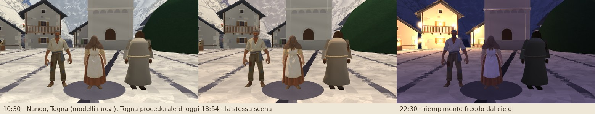
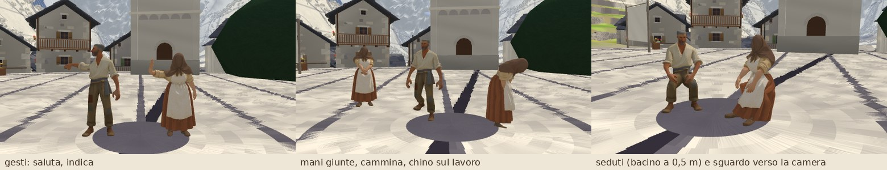
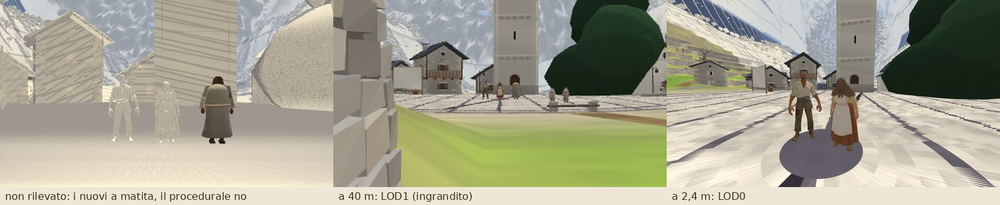

# Personaggi nuovi: il modulo di gioco (`src/personaggi/`)

Il pilota ([PIPELINE.md](PIPELINE.md)) ha prodotto i GLB con lo scheletro di 17 ossa. Questo modulo li porta nel gioco con **la stessa interfaccia della figura procedurale** (`creaAbitante`), così il popolamento cambia una riga sola. **Non è ancora collegato**: lo collega l'integratore, quando il rifacimento grafico avrà chiuso `src/popolamento/**` e `src/oggetti/**` (sotto le quattro modifiche da fare).





Le schermate sono del gioco vero (piazza delle Ore, `?nuova` e poi la regia fuori dalla capsula), fatte con `node tools/personaggi/nel-gioco.mjs`: i modelli del pilota (`togna`, `nando`) messi accanto alla camera con questo modulo, e la figura procedurale di oggi per confronto.

## In breve

```ts
import { collegaMotorePersonaggi, creaPersonaggio, precaricaPersonaggi } from './personaggi';

await precaricaPersonaggi((frazione, id) => …);          // una volta, prima di costruire Corbella
collegaMotorePersonaggi({ uniforms: game.uniforms, camera: game.camera });
const obj = creaPersonaggio('togna', aspetto) ?? creaAbitante(aspetto);   // OggettoProcedurale<StatoAbitante>
```

| file | cosa fa |
|---|---|
| `precarica.ts` | `precaricaPersonaggi(onProgress?, { ids?, cartella? })`: legge `personaggi/indice.json`, scarica i GLB (GLTFLoader di `three/addons`) una volta sola, li prepara (texture «da pittore», misure a riposo, attributo `aOrlo`, sfere per il culling). Non fallisce mai: restituisce `{ caricati, mancanti, errori }`. Percorsi relativi a `import.meta.env.BASE_URL` risolto su `document.baseURI` (il gioco gira con base `./`, anche in un iframe). `collegaMotorePersonaggi`, `impostaDistanzePersonaggi`, `registraPrototipo` (prove). |
| `fabbrica.ts` | `creaPersonaggio(chi, opz: OpzioniAbitante): OggettoProcedurale<StatoAbitante> \| null`. null se il modello non c'è: chi chiama usa `creaAbitante`. Copia con `SkeletonUtils.clone` (geometria e texture condivise, scheletro e materiale propri). |
| `schede.ts` | le schede dei 13 modelli (altezza, gonna, apertura delle braccia, generico), la scelta del modello (`scegliModello`), la lettura tollerante dell'indice (`leggiIndice`), le scelte casuali della figura procedurale ripetute (`derivaProcedurale`). |
| `animatore.ts` | l'animazione procedurale sulle ossa (del pilota, estesa): respiro, peso, passo legato alla velocità, sguardo, gesti, posture, **seduto** e **chino**, carattere dal seme, bastone. Nessuna allocazione per fotogramma. |
| `materiale.ts` | la variante del **materiale del mondo** con texture e skinning (luce della Linea, foschia, lampade, matita); toon di ripiego senza gli uniform del motore. |
| `carica.ts` | il caricamento libero del pilota, solo per la pagina `tools/personaggi/prova.html`. |

## Il contratto (uguale alla figura procedurale)

- `gruppo`: y = 0 al suolo, fronte su +Z, `userData.personaggio = <id del modello>`.
- `collider`: lo **stesso cilindro** `'personaggio'` della figura procedurale con le stesse opzioni (raggio 0,3 × larghezza della corporatura, ripetendo la sequenza casuale di `creaAbitante`: verificato da un test su tutti i velati e su Togna e Annunciata), alto quanto il modello. La fisica del popolamento (`aggiornaCollider`, raggio 0,3, altezza da `ingombro.altezza`) non cambia.
- `ingombro`: raggio a riposo, altezza del modello (quella della Bibbia), `interrata` 0.
- `punti`: `testa`, `manoDestra`, `manoSinistra` (come la figura procedurale) e in più `petto`, `bacino`, `cima`.
- `update(dt, stato)`: `modo` fermo/cammina, `velocita` (cadenza e ampiezza del passo), `guarda` (testa, collo e oltre 45° anche il busto, verso un punto MONDO, con limiti ±75° e ±30°/35° e inerzia), `gesto` (`saluta`, `indica`, `mano-al-petto`), `indica`. In più `posa` (`'in-piedi' | 'seduto' | 'chino'`), tipo esportato `StatoPersonaggioGioco`.
- `dispose()`: libera i materiali propri (geometria e texture sono condivise fra le copie).

**Postura dalle opzioni**: la `postura` procedurale (o quella che il seme avrebbe scelto) diventa `curvo` e `braccia` dell'animatore: `curva` → curvo 0,6 (0,75 per gli anziani); `mani-giunte`, `braccia-conserte`, `mani-dietro` → la posa delle braccia con l'IK; gli anziani sono sempre un po' curvi. `bastone: true` → bastone di castagno dalla mano destra a terra (la mano lo regge avanti, all'altezza del fianco). `gerla: true` sceglie il velato con la gerla.

**Prese per gli oggetti di scena**: ossa in più (non dello scheletro) `presaD`, `presaS` (sul palmo), `cintura` (bacino), `dorso` (petto, dietro), con gli assi del modello a riposo: un oggetto figlio con posizione (0, 0, 0) sta nel palmo, +Y in alto, +Z avanti, come sulle ossa della figura procedurale. Le ossa dello scheletro del GLB invece hanno gli assi di Blender (Y lungo l'osso).

**Scelta del modello** (`scegliModello`): chi ha un modello suo (`ottavio`, `togna`, `bortolo`, `pina`, `annunciata`, `nando`, `clelia`, `lisa`, `gioanin`; anche `la_madre`, `rosa` se un giorno ci sarà il file) usa quello; i velati `velato_N` usano il generico del loro copricapo: velo → `velata_donna`, cappello o gerla → `velato_gerla`, maschera o bastone → `velato_maschera`, cappuccio o velo da apicoltore → `velato_cappuccio`. Se il generico preferito manca si prende un altro generico caricato; se non ce n'è nessuno, null. **Varianti dei generici** (senza crediti): scala ±4% in altezza e ±5% in larghezza (più larghi i robusti, più bassi gli anziani), tinta leggera (12-22%) dal colore della veste procedurale, carattere del movimento dal seme.

## Le quattro modifiche per collegarlo

1. **`src/main.ts`**, prima di `installaCorbella` (riga ~66):
   ```ts
   import { collegaMotorePersonaggi, precaricaPersonaggi } from './personaggi';
   …
   collegaMotorePersonaggi({ uniforms: game.uniforms, camera: game.camera });
   await precaricaPersonaggi((f) => ui.caricamento.progresso(0.88 + 0.02 * f, 'la gente di Corbella'));
   const corbella = installaCorbella(game, { … });
   ```
   I 13 GLB fanno circa 5 MB: si scaricano in parallelo durante la schermata di caricamento. Senza file (o senza indice) l'esito lo dice e la gente resta procedurale.

2. **`src/popolamento/abitanti.ts`, `crea()`** (riga 229):
   ```ts
   obj = creaPersonaggio(id, aspetto) ?? creaAbitante(aspetto);
   ```
   `id` è quello del popolamento (`togna`, `velato_3`…). Il tipo è lo stesso (`OggettoProcedurale<StatoAbitante>`).

3. **`posaOssa()`** (riga 681) scrive rotazioni di Eulero sulle ossa della figura procedurale (e sull'osso `radice`, che i modelli nuovi non hanno): per i personaggi nuovi va saltata e la posa passa dallo stato. In `update()` (riga 638):
   ```ts
   const nuovo = !!s.obj.gruppo.userData['personaggio'];
   if (nuovo) (s.stato as StatoPersonaggioGioco).posa = s.posa;
   s.obj.update?.(dt, s.stato);
   if (!nuovo) this.posaOssa(s);
   ```
   Seduti: il bacino scende a 0,5 m dall'origine e 12 cm indietro, come faceva `posaOssa` (i `sopra` dei `PIAZZAMENTI` restano validi). Chini: schiena e petto avanti (40° in tutto), ginocchia morbide, le mani avanti e in basso con un lento lavorare.

4. **`accessori()`** (riga ~276): la pietra di Nando va sulla presa della mano, non sull'avambraccio:
   ```ts
   const presa = osso('presaD');
   if (presa) { g.position.set(0, -0.03, 0.03); presa.add(g); }
   else { g.position.set(-0.05, -0.32, 0.05); osso('avambraccioD')?.add(g); }
   ```
   Il lume di Ottavio sul `bacino` va bene così (l'osso del bacino ha gli assi quasi uguali al modello); il Velo da planata si aggiunge al gruppo e `png.ts` lo trova ancora per nome (`velo-ottavio`). Per gli oggetti nuovi della Bibbia (forbici e cartone di Pina, pacchetto di Clelia) si usano `presaD`/`presaS` allo stesso modo.

Le luci che regia e popolamento mettono per le figure servono ancora ai procedurali di ripiego; i modelli nuovi con il materiale del mondo non le usano.

## L'indice dei modelli (`public/personaggi/indice.json`)

Lo scrive la pipeline degli asset. `leggiIndice` accetta:
```json
{ "personaggi": [ { "id": "togna", "file": "togna.glb", "altezza": 1.62, "gonna": 0.09 }, { "id": "nando", "gonna": null } ] }
```
oppure `["togna", "nando"]`, `{ "personaggi": ["togna"] }`, `{ "personaggi": { "togna": {…} } }`, `{ "togna": {…} }`. `file` è relativo a `personaggi/` (predefinito `<id>.glb`); `gonna` è un booleano o la quota dell'orlo della pipeline (numero = sì, null = no); `altezza` e `apertura` correggono le schede. Le chiavi che cominciano con `_` sono commenti. **Senza indice** si provano i modelli del pilota (`togna`, `nando`).

## Il materiale

`creaMaterialeMondo(game.uniforms, { mappa, tinta })` è un `ShaderMaterial` con gli **uniform del mondo per riferimento** (lo spread `{ ...u }` copia gli oggetti `{ value }`: il motore li aggiorna anche per i personaggi) più `uMappa`, `uTinta`, `uOnda`, `uBrush`, `uRiempimento`. Il vertice usa i pezzi di skinning di three (`skinning_pars_vertex`, `skinbase_vertex`, `skinnormal_vertex`, `skinning_vertex`); il frammento segue la variante `object` di `worldMaterial.ts`:

- pezzi di `src/render/shaders/common.ts`, per nome e nell'ordine di `worldMaterial.ts`: `WORLD_UNIFORMS_GLSL`, `NOISE_GLSL`, `LIGHT_GLSL`, `BRUSH_GLSL`, `PENCIL_GLSL`;
- funzioni GLSL: `shadeLit(albedo, N, P, out tone)`, `applyHazeK(col, P, dist, k)`, `paintState(P, thetaDeg, dist)`, `pencilColor(uv, N, V, tone, hgt, dist, blank, steep, inked)`, `tangentUV`, `brushStrokes`, `vnoise3`, `cylUp`, `cylThetaDeg`.

In più, solo per i personaggi: un **riempimento freddo dal cielo** (`RIEMPIMENTO`: 0,1 di giorno, 0,6 di notte, di `uAmbTop` sull'albedo) e di notte un filo di controluce sulla sagoma: nel materiale del mondo le superfici in piedi prendono poco cielo, e di notte i vestiti scuri diventavano sagome nere, mentre nei bozzetti notturni (finale-5) le figure si leggono in blu-viola. L'**orlo** di gonne e vesti ondeggia appena (1,1% dell'altezza, di più nel passo; attributo `aOrlo` calcolato al caricamento per i modelli con la gonna).

Il rifacimento grafico riscrive `common.ts`: se cambia una firma o l'ordine dei pezzi va adattato solo `sorgenteFrammento()` in `materiale.ts`. La prova:
```sh
node tools/personaggi/compila.mjs --ramo=grafica/luce     # compila il materiale con common.ts di questo ramo e di grafica/luce
```
Oggi compila con tutti e due. La post-produzione di `grafica/post` legge solo colore e profondità, che il materiale scrive. Se `grafica/luce` disegna le ombre portate con un materiale proprio (`uOmbraMappa`), quel materiale deve avere lo skinning per le `SkinnedMesh` (o le ombre dei personaggi restano alla posa di riposo).

Senza gli uniform del motore (pagina di prova, Node) si usa il toon di ripiego; quando arrivano gli uniform (`collegaMotorePersonaggi`), i personaggi già creati cambiano materiale.

## Prestazioni

| distanza dalla camera | modello | animazione |
|---|---|---|
| fino a 25 m | LOD0 (8000 triangoli) | ogni fotogramma |
| 25-60 m | LOD1 (2000 triangoli) | 30 Hz |
| 60-120 m | LOD1 | 15 Hz |
| 120-230 m | LOD1, senza ombra portata | 6 Hz |
| oltre 230 m | non si disegna né si anima | — |

Isteresi di 2 m a ogni confine; gli aggiornamenti dei lontani sono sfasati (non tutti nello stesso fotogramma). A 130 m un personaggio è alto 2-3 pixel. Oltre 230 m si è scelto «niente» invece di una figura semplice: la figura procedurale costerebbe come il LOD1, e a quella distanza è sotto i 2 pixel e dentro la foschia. Le distanze si cambiano con `impostaDistanzePersonaggi`. Una copia costa uno scheletro di 17 ossa (più 4 prese), due `SkinnedMesh` (una sola visibile: una chiamata di disegno) e un materiale; nessuna allocazione per fotogramma (vettori e quaternioni di lavoro del modulo, stato riusato, distanza letta da `matrixWorld`).

## Le prove

- `tests/personaggi/modulo.test.ts` (20 prove, in Node, con un modello sintetico di 17 ossa con orientamenti di riposo casuali, `tests/personaggi/sintetico.ts`): scelta del modello per nome e per i 12 velati, ripiego sui generici, null senza modelli; collider uguale a quello di `creaAbitante` per tutti i velati, Togna e Annunciata; le forme dell'indice; `precaricaPersonaggi` senza rete e con il 404; contratto (suolo, punti, prese, piedi a terra); passo in controfase; sguardo verso un punto; seduto (anche a 0,5 m) e chino; mani giunte dalla postura; bastone da terra alla mano; varianti dei velati; passaggio al materiale del mondo con gli uniform per riferimento; livelli di dettaglio con l'isteresi; animazione a 6 Hz da lontano; carattere dal seme.
- `tests/personaggi/animatore.test.ts` (del pilota): braccia, piedi, IK della mano sul petto, testa.
- `node tools/personaggi/nel-gioco.mjs --out=<cartella> [--solo=giorno,primo,gesti,pose,seduti,sera,notte,lontano,matita]`: le schermate qui sopra, nel gioco vero (Vite in sviluppo, modalità e2e).
- `node tools/personaggi/compila.mjs [--ramo=…]`: la compilazione del materiale.

## Limiti noti e cose da fare

- **Gonne da sedute**: i pesi della gonna (15-55% alle gambe) la fanno restare quasi verticale quando le cosce vanno avanti: da vicino Togna seduta sembra appollaiata. Per Pina, Annunciata e Lisa sedute conviene provare con i loro modelli; se serve, una seduta più alta per chi ha la gonna o un ritocco dei pesi in `processa.py`.
- I **veli** non ondeggiano (solo l'orlo delle gonne): per farlo servirebbe una maschera del velo nella texture o un attributo dalla pipeline.
- **Ombre portate** del rifacimento grafico: vedi sopra (skinning nel materiale delle ombre).
- La camminata è «sul posto» come quella procedurale: lo spostamento lo fa il popolamento (`passo()`), il passo si accorda con `velocita`.
- I modelli degli altri 11 personaggi li produce il lavoro degli asset: per ognuno basta il file in `public/personaggi/` e la voce nell'indice. Le schede in `schede.ts` hanno già altezza, gonna e apertura della Bibbia.
