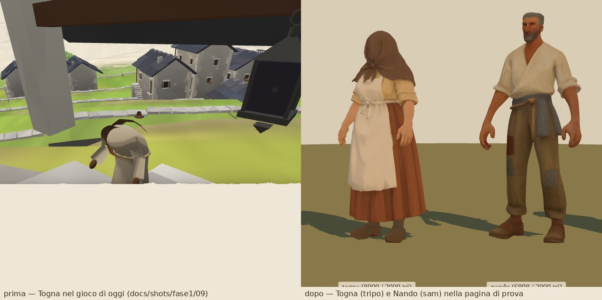
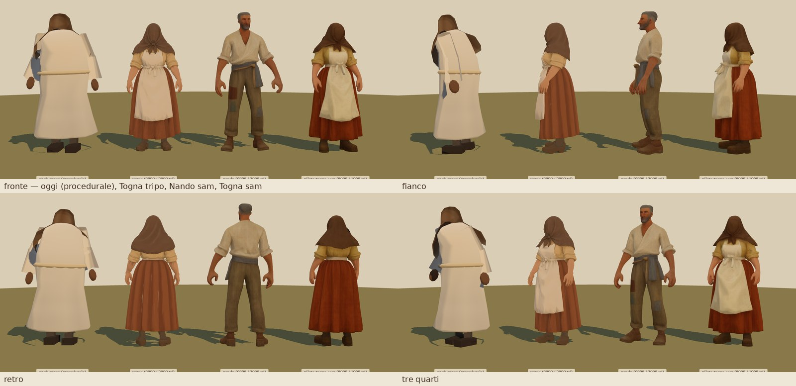
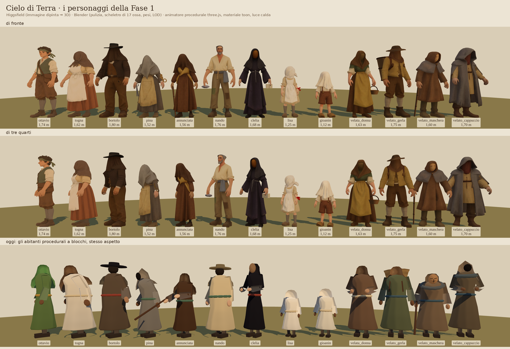
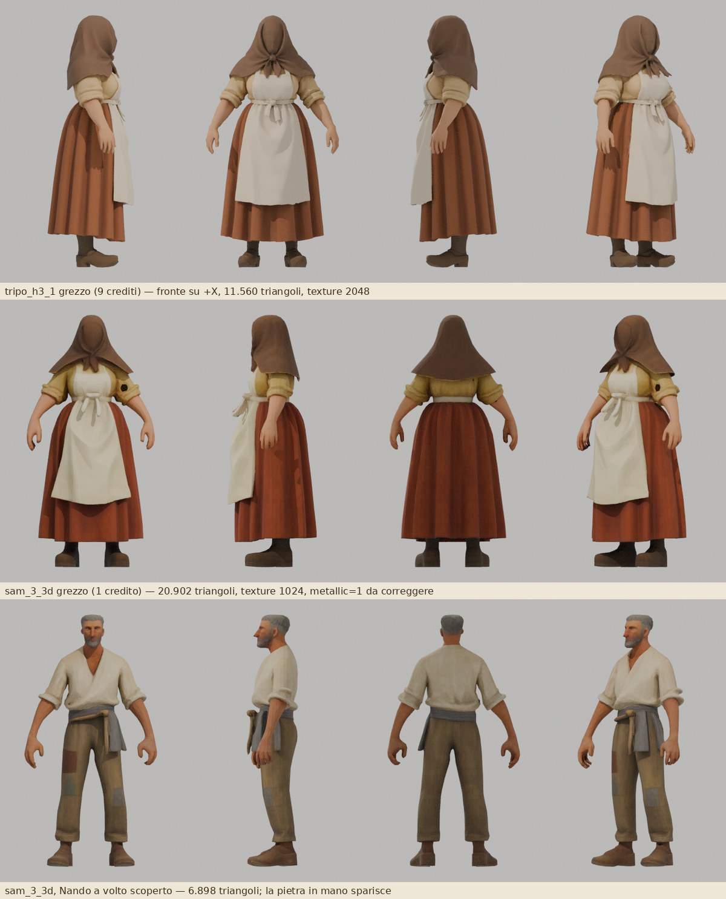
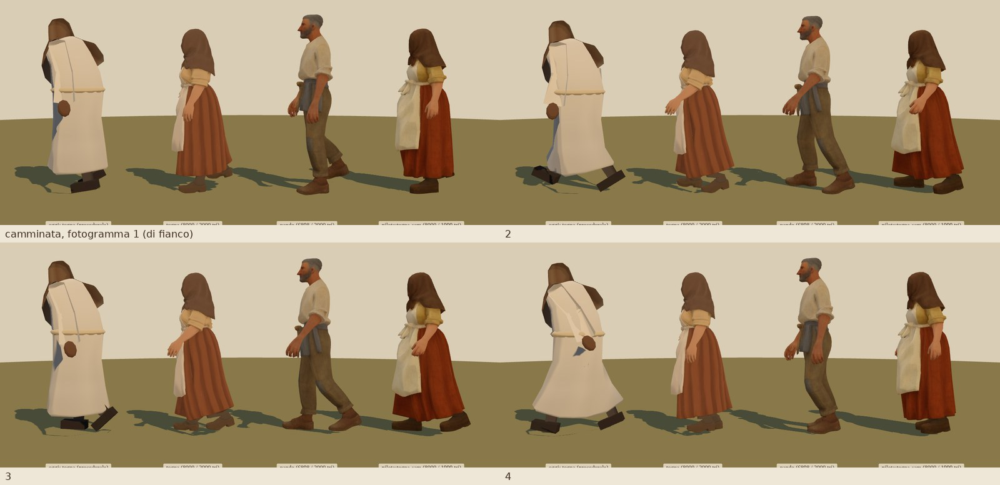
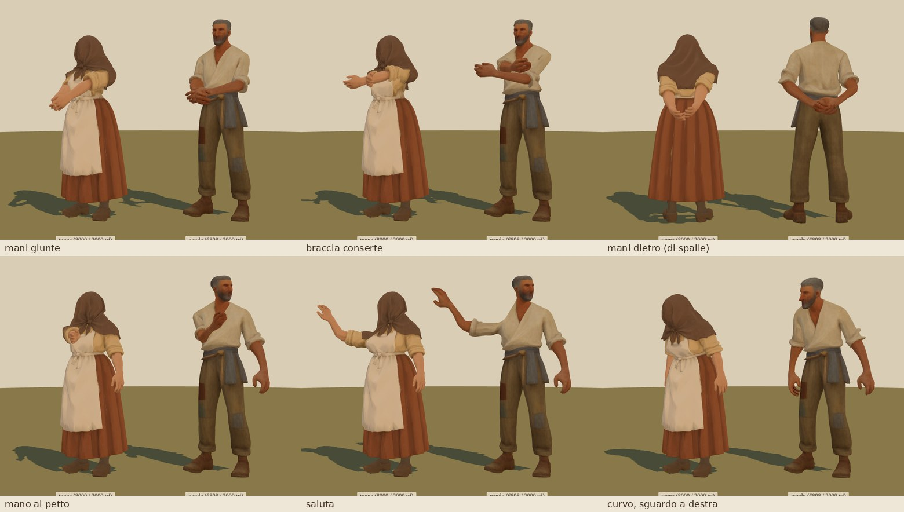
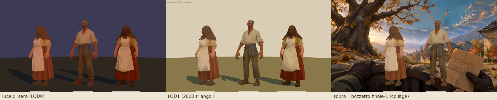

# Personaggi nuovi: la pipeline (decisione del pilota, poi la produzione dei 13)

L'utente: «anche i personaggi non mi piacciono per niente… creali con Higgsfield o su Blender, vedi tu». Gli abitanti di oggi sono figure procedurali a blocchi (`src/oggetti/oggetti/abitante.ts`). Il pilota ha provato a sostituirli con modelli **generati da un'immagine dipinta** e **rigati in Blender**, animati in modo procedurale come prima.

Che aspetto deve avere ciascuno e con quali prompt: [BIBBIA.md](BIBBIA.md). Crediti spesi: [crediti.md](crediti.md). Immagini del pilota: [`pilota/`](pilota/).




## La produzione: tutti i 13 modelli della Fase 1



Fatti tutti e 13 con la pipeline decisa dal pilota: `public/personaggi/<id>.glb` (ottavio, togna, bortolo, pina, annunciata, nando, clelia, lisa, gioanin, velata_donna, velato_gerla, velato_maschera, velato_cappuccio) e l'indice `public/personaggi/indice.json`. Da 359 a 447 KB l'uno, **5,1 MB in tutto** (tetto: 1,5 MB a file, 18 MB in tutto). La scheda la rifà `node tools/personaggi/scheda.mjs`.

**Immagini sorgente** ([`sorgenti/tutte.jpg`](sorgenti/tutte.jpg), una a personaggio in [`sorgenti/`](sorgenti/)): `gpt_image_2_5` con la sorgente di Togna del pilota come **riferimento di stile** (`medias: [{ role: "image_references" }]`, stesso costo), prompt composto da `tools/personaggi/prompt.py` (STILE + RIFERIMENTO + personaggio + VELO | MASCHERA | VOLTO + POSA), due varianti a personaggio. Tutte e 24 erano buone al primo colpo: a figura intera, in A-pose, fondo uniforme, nessun volto sotto i veli, accessori giusti. Si è scelta la variante con le braccia più staccate dal corpo e il velo che non copre le braccia (per lo scheletro); i job e la variante scelta sono in `tools/personaggi/produzione.json`. La frase VOLTO, con l'aggiunta «the face is as simplified and painterly as the clothes, clearly not a photograph», ha dato a Ottavio e al nuovo Nando volti dipinti e semplici (Nando del pilota era quasi una foto).

**3D**: `tripo_h3_1_image_to_3d` per Ottavio (9 crediti), `sam_3_3d` per gli altri dieci nuovi più il nuovo Nando (1 credito l'uno; il primo tentativo di Gioanin è fallito ed è stato rimborsato, il secondo con il prompt «the child» è andato). Togna resta quella tripo del pilota, ripassata nella pipeline nuova. I GLB grezzi sono in `tools/personaggi/grezzi/` (servono a rifare la pipeline senza spendere).

**Crediti**: 32 nella produzione, 45 in tutto con il pilota, sotto il tetto di 50 (saldo da 76,97 a 31,97). Dettaglio in [crediti.md](crediti.md).

**Che cosa è cambiato nella pipeline** (rispetto al pilota, tutti e 13 rifatti con la versione nuova):
1. **Braccia**: il metodo «gruppo più esterno delle sezioni» sbagliava con le maniche larghe e le mesh rade (il gomito di Clelia e di Pina finiva fuori dal braccio, uno dei due lati di Nando non trovava sezioni). Ora polso e gomito sono il centro dell'anello della manica e le due braccia si rendono simmetriche (scarto fra i lati prima della media: da 0,001 a 0,03 H).
2. **Pesi di omero e gomito**: gli sbuffi e il dietro delle maniche larghe (velata_donna, Pina, velato_cappuccio) erano al petto e restavano indietro, scuri, quando le braccia si abbassano. Nuova correzione (passo 7).
3. **Texel neri**: riempiti dai vicini (passo 8): via le macchie nere sui panni e sulle dita.
4. **Collo**: le fasce senza vertici non contano più come «collo strettissimo» (velato_gerla lo trovava sotto la tesa del cappello).
5. **Altezza nel gioco** (`src/personaggi/carica.ts`): con `KHR_mesh_quantization` l'ingombro della geometria è in unità quantizzate e `caricaPersonaggio` dava a tutti 2,00 m (quindi passo, abbassamento e posizione delle mani sbagliati). Ora si misura dai vertici deformati dallo scheletro a riposo; anche la sfera per il frustum culling è quella della SkinnedMesh.

**Oggetti di scena** (`src/personaggi/oggetti.ts`, `attaccaOggetto(modello, 'bastone@manoD')`): gerla, bastone, forbici, figura di cartone, pacchetto, pietra, cesto, procedurali e attaccati alle ossa nella posa di riposo; l'indice dice chi porta che cosa. La **gerla** di velato_gerla l'ha buttata `sam_3_3d` (ritaglia la persona, come la pietra di Nando nel pilota): ora è un oggetto di scena sull'osso `petto`, che può anche essere carica.

**Controlli fatti** (pagina di prova, Chromium con SwiftShader, tutti e 13 in fila): di fronte e di tre quarti ([scheda](scheda-cast.png)), camminata ([`produzione/cammina.jpg`](produzione/cammina.jpg)), gesti e curvo ([`produzione/gesti.jpg`](produzione/gesti.jpg)), pose delle braccia ([`produzione/pose.jpg`](produzione/pose.jpg)), luce di sera con il LOD1 forzato ([`produzione/sera-lod1.jpg`](produzione/sera-lod1.jpg)), pesi colorati ([`produzione/pesi.jpg`](produzione/pesi.jpg)), anteprime Cycles con le giunture ([`produzione/rig-blender.jpg`](produzione/rig-blender.jpg)).

**Difetti noti** (piccoli, alla distanza di gioco non si vedono):
- velato_cappuccio ha due punte sottili del mantello all'altezza del gomito che restano un poco fuori quando le braccia sono giù;
- i lati che l'immagine non mostra li inventa il generatore: il retro dei veli e dei mantelli è più liscio e un po' più scuro del davanti;
- con un oggetto in `manoD` (il bastone di Annunciata e dell'anziano) i gesti del braccio destro portano in aria anche l'oggetto: chi integra deve usare l'altra mano, posare il bastone o non fare gesti;
- le mani di sam sono «a paletta» (dita poco separate); quelle di tripo (Ottavio, Togna) hanno le dita.

L'indice (`public/personaggi/indice.json`, tipizzato in `src/personaggi/indice.ts`):
```json
{ "versione": 1, "unita": "metri…", "orientamento": "glTF: +Y in alto, guarda +Z, la sua sinistra è +X; piedi a y = 0…",
  "ossa": ["bacino", "schiena", "petto", "collo", "testa", "braccioS", "avambraccioS", "manoS", "braccioD", "avambraccioD", "manoD",
           "cosciaS", "stincoS", "piedeS", "cosciaD", "stincoD", "piedeD"],
  "totale_kb": 5222,
  "personaggi": [ { "id": "annunciata", "file": "annunciata.glb", "lod1": { "file": "annunciata.glb", "mesh": "lod1", "triangoli": 2000 },
                    "lod0": { "mesh": "lod0", "triangoli": 8000 }, "altezza": 1.56, "ossa": […17…], "kb": 379, "generatore": "sam_3_3d",
                    "proporzioni": "adulto", "volto": "velo", "gonna": true, "apertura": 11, "curvo": 0.55,
                    "oggetti": ["bastone@manoD"], "note": "…" }, … ] }
```
Lo scrive `python3 -I tools/personaggi/indice.py` (che controlla anche ossa, LOD e limiti di peso); le indicazioni per il gioco (volto, gonna, apertura, curvo, oggetti, note) stanno in testa a quel file. Il test `tests/personaggi/asset.test.ts` verifica indice e GLB.

## La decisione in breve

| passo | scelta | costo |
|---|---|---|
| immagine sorgente | `gpt_image_2_5`, qualità media, 1k, 2:3, **2 varianti** per personaggio, prompt = STILE + personaggio (+ VELO o VOLTO) + POSA della Bibbia | 1 credito per 2 varianti |
| 3D principale | **`sam_3_3d`** per 11 dei 13 modelli | 1 credito |
| 3D di pregio | **`tripo_h3_1_image_to_3d`** per Togna (fatta nel pilota) e **Ottavio**, che il giocatore vede da vicino più di tutti | 9 crediti |
| pulizia, scala, LOD, texture | `tools/personaggi/processa.py` (bpy 5.2, senza interfaccia) | 0 |
| rig | scheletro umanoide di 17 ossa **costruito dallo script** dalle proporzioni del modello; pesi col **bone heat di Blender** sul modello pulito (ripiego automatico su un proxy a voxel) più correzioni geometriche (braccia, gonne, testa, piedi) | 0 |
| animazione | **procedurale** in three.js (`src/personaggi/animatore.ts`): respiro, peso, camminata, sguardo, gesti, pose delle braccia con IK; nessuna clip | 0 |
| peso | GLB con `lod0` 8000 e `lod1` 2000 triangoli sullo stesso scheletro, texture JPEG 1024, geometria quantizzata (`KHR_mesh_quantization`): **circa 390 KB** a personaggio | 0 |

Niente rig a pagamento (`meshy_rigging`, 8 crediti) né clip di animazione: il gioco anima già tutti gli abitanti in modo procedurale (`update(dt, stato)`), e lo scheletro fatto in casa ha nomi e assi che decidiamo noi.

## Il confronto del pilota: Togna con tripo e con sam

Stessa immagine sorgente (`pilota/sorgenti.jpg`, la «b»), due generatori:



| | `tripo_h3_1_image_to_3d` (9 crediti) | `sam_3_3d` (1 credito) |
|---|---|---|
| triangoli grezzi | 11.560 (face_limit 12.000) | 20.902 (Togna), 6.898 (Nando) |
| texture | 2048, pulita anche di lato e dietro | 1024, più rumorosa; qualche macchia (una scura sulla manica di Togna) |
| materiale | metallic 0, roughness 0,9 | **metallic 1**: va azzerato (lo fa la pipeline) |
| topologia dopo la fusione dei doppi | 1 isola, 15 bordi aperti | 1 isola, **chiusa** (0 bordi aperti) |
| orientamento | fronte su **+X** (va ruotato di -90°) | fronte su -Y di Blender (= +Z del glTF, già giusto) |
| scala | altezza 1 | altezza 1 |
| forma | pieghe nette, mani con le dita, proporzioni fedeli all'immagine | più morbida e un po' più tozza; mani impastate |
| oggetti in mano | li tiene | li **butta** (la pietra di Nando è sparita) |
| bone heat diretto | riuscito (0% di vertici senza peso) | riuscito (0%) |

Il risultato di `sam_3_3d` è molto migliore del previsto, e alla distanza di gioco (3-30 m) la differenza con tripo si vede poco ([`pilota/confronto-viste.jpg`](pilota/confronto-viste.jpg), terza e quarta figura). Con 50 crediti di tetto e 13 modelli tripo per tutti costerebbe 117: si usa dove si guarda da vicino. Anche il volto scoperto di Nando con sam regge (prova fatta apposta, 2 crediti), ma è ancora troppo realistico: la colpa è dell'immagine, non del 3D, e la Bibbia ora ha la frase VOLTO.

### Il piano dei crediti per gli altri 11
Spesi nel pilota: **13** (Togna 11, Nando 2). Tetto: 50.

| voce | crediti |
|---|---|
| 11 immagini sorgente × 2 varianti (ottavio, bortolo, pina, annunciata, clelia, lisa, gioanin, 4 generici) | 11 |
| 10 conversioni `sam_3_3d` | 10 |
| Ottavio con `tripo_h3_1_image_to_3d` | 9 |
| **totale** | **30** → 43 su 50 |
| margine: rifare l'immagine di Nando con VOLTO (2), ritiri di sam con un altro `seed` (1 l'uno) | 7 |

Preventivi verificati e scartati: `tripo_p2_image_to_3d` 34 crediti, `meshy_v7_image_to_3d` lowpoly testurizzato 38, `hunyuan3d` LowPoly 14.

## I parametri esatti

**Immagine** (`mcp__higgsfield__generate_image`):
```json
{ "model": "gpt_image_2_5", "quality": "medium", "resolution": "1k", "aspect_ratio": "2:3", "count": 2,
  "use_unlim": false, "prompt": "<STILE> <personaggio> <VELO|VOLTO> <POSA>" }
```
Si sceglie la variante più pittorica (pennellata visibile, meno «foto»), con le braccia ben staccate e le mani vuote.

**3D, sam** (`mcp__higgsfield__generate_3d`): `{ "model": "sam_3_3d", "medias": [{ "value": "<job immagine>", "role": "image" }], "prompt": "the woman" | "the man" | "the child", "export_textured_glb": true }`. Se esce male: stesso job con `"seed": <n>`.

**3D, tripo**: `{ "model": "tripo_h3_1_image_to_3d", "medias": [{ "value": "<job immagine>", "role": "image_references" }], "face_limit": 12000, "texture": true, "pbr": false, "texture_quality": "standard", "geometry_quality": "standard", "orientation": "align_image" }`.

Si scarica il GLB con `curl` dall'URL del risultato in `tools/personaggi/pilota/<id>-<generatore>-grezzo.glb` (sotto i 3 MB: sam 1,5 MB, tripo 1 MB) e si aggiunge una voce in `tools/personaggi/personaggi.json`.

## La pipeline in Blender: `tools/personaggi/processa.py`

```sh
pip install bpy                      # bpy 5.2.2 per Python 3.13 (una volta)
python3 -I tools/personaggi/processa.py --id togna [--anteprima /tmp/togna.png]
```
Legge i parametri da `tools/personaggi/personaggi.json`:

| campo | significato |
|---|---|
| `entrata`, `uscita` | GLB grezzo e GLB del gioco (`public/personaggi/<id>.glb`) |
| `altezza` | metri (la Bibbia li dà per ognuno) |
| `gonna` | quota dell'orlo in frazioni dell'altezza per vesti e gonne lunghe (Togna 0,09), `null` altrimenti |
| `ruota` | gradi attorno all'alto: **-90 per tripo**, 0 per sam |
| `proporzioni` | `adulto` (testa 1/7) o `bambino` (testa 1/5: Lisa, Gioanin) |
| `pesi` | `diretto` (predefinito) o `proxy` |
| `lod0`, `lod1`, `texture`, `jpeg`, `formato`, `quantizza` | 8000, 2000, 1024, 85, `jpeg`, 1 |

I passi:
1. **import** del GLB, unione delle mesh, trasformazioni applicate, normali personalizzate tolte;
2. **pulizia**: fusione dei vertici doppi (le cuciture UV che il glTF separa: dopo la fusione tripo e sam danno un'isola sola), geometria degenere, briciole staccate (<0,15% dei vertici e <3% dell'altezza);
3. **in piedi**: asse più lungo in alto, rotazione `ruota`, fronte su -Y di Blender = +Z del glTF (come gli abitanti del gioco), piedi a y = 0, centrato sui fianchi, scala all'altezza;
4. **analisi delle proporzioni**: piedi (i due gruppi più bassi), mani (gli estremi laterali), **braccia** (dalla produzione: punta delle dita misurata; polso e gomito al **centro dell'anello** di vertici della manica attorno a una retta di prima stima spalla-polso; spalla 0,045 H dentro il bordo delle spalle; poi le due braccia si rendono **simmetriche**, media dei due lati, perché le sorgenti sono in A-pose simmetrica), raggio dell'avambraccio (ampiezza dell'anello a metà avambraccio), **collo** (la sezione più stretta fra spalle e testa, se c'è e se la fascia non è vuota; sotto i veli valgono le proporzioni);
5. **armatura** di 17 ossa (`bacino`, `schiena`, `petto`, `collo`, `testa`, `braccio/avambraccio/mano` S e D, `coscia/stinco/piede` S e D; S = sinistra del personaggio = +X);
6. **LOD** per decimazione a collasso: 8000 e 2000 triangoli;
7. **pesi**: bone heat sul modello pulito (se lascia più del 2% di vertici senza peso, sul proxy rimeshato a voxel), poi trasferimento ai LOD (punto più vicino, baricentriche) e correzioni:
   - **braccia**: le ossa del braccio valgono solo per i vertici raggiungibili dalla punta delle dita lungo la mesh, oltre il primo quinto dell'asse spalla-polso ed entro 0,12 H dalla catena; sotto il gomito l'avambraccio e la mano hanno pesi geometrici puri (niente cosce sulle mani vicine alla gonna);
   - **omero e gomito** (dalla produzione): sopra il bacino, fra un quarto e quattro quinti dell'asse spalla-polso, i vertici molto più vicini alla catena del braccio che all'asse del busto (rapporto < 0,25, sfumato fino a 0,45) vanno al braccio anche se il bone heat li dava al petto: gli sbuffi delle maniche e il dietro delle maniche larghe restavano indietro quando l'animatore abbassa le braccia, e se ne vedeva l'interno scuro ([`produzione/pesi.jpg`](produzione/pesi.jpg));
   - **gonne**: fra l'anca e l'orlo le gambe pesano dal 15% (anca) al 55% (orlo), il resto al bacino, destra e sinistra sfumate al centro: la gonna segue il passo senza strapparsi;
   - **testa**: sopra l'attacco della testa tutto alla testa (veli e cappelli rigidi);
   - **piedi**: sotto la caviglia almeno il 60% al piede;
   - massimo 4 influenze, normalizzate;
8. **materiale**: metallic 0, roughness 1, solo la texture del colore, ridotta a 1024; i **texel quasi neri** dell'atlante (sam lascia nero dove l'immagine non arriva: punte delle dita, risvolti, l'interno dei veli; 1-3% della texture) si riempiono con la media dei vicini, a passi (dove il nero è vero, come la veste di Clelia, i vicini sono scuri e non cambia niente);
9. **esportazione** GLB (armatura + `lod0` + `lod1`, stesso materiale), poi **quantizzazione** con `npx -y @gltf-transform/cli@4.5.1 quantize` (l'esportatore di Blender non quantizza; la compressione meshopt del pacchetto bpy non funziona): da 580 a 390 KB;
10. rapporto in `tools/personaggi/rapporti/<id>.json` (giunture in assi glTF, triangoli, KB).

Con `--anteprima file.png` fa una striscia Cycles (CPU, senza GPU): riposo di fronte con le giunture in rosso, di fianco, una posa di camminata e un saluto ([`pilota/rig-blender.jpg`](pilota/rig-blender.jpg); per tutti i 13: [`produzione/rig-blender.jpg`](produzione/rig-blender.jpg)). Strumenti di servizio: `ispeziona.py` (triangoli, isole, bordi aperti, materiali, ingombro), `anteprima.py` (striscia del GLB grezzo), `peso-glb.mjs` (quanto pesa ogni parte), `mosaico.py` (mette insieme le schermate).

## Nel gioco: `src/personaggi/`

- `ossa.ts`: nomi e gerarchia delle 17 ossa.
- `animatore.ts`, `AnimatorePersonaggio`: `update(dt, stato)` con lo stesso stato degli abitanti procedurali (`modo`, `velocita`, `guarda`, `gesto`, `indica`) più `curvo` (0..1) e `braccia` (`mani-giunte`, `braccia-conserte`, `mani-dietro`). Le rotazioni si scrivono **nello spazio del modello** (`osso.quaternion = riposo · W⁻¹ · R · W`), quindi non dipendono dal rollio delle ossa esportate da Blender. Fa: braccia giù dalla posa ad A fino all'`apertura` voluta, respiro, peso che si sposta, camminata (passo più corto con la `gonna`), abbassamento del bacino, sguardo con limiti e inerzia, gesti (saluta, indica, mano al petto) e pose con un'**IK a due ossa** (`raggiungi(lato, punto)`, buona anche per le mani di Togna nella vasca o sul bastone).
- `carica.ts`, `caricaPersonaggio(url, opz)`: scarica il GLB una volta, ne fa copie indipendenti (`SkeletonUtils.clone`), sostituisce il materiale (`toon` a tre campiture come la libreria, oppure `lambert`/`originale`), sceglie il LOD con isteresi (`distanzaLod`, 16 m), misura dove sta il petto per le mani, `tinta` per le varianti. Con `colore: 'grezzo'` la texture non viene decodificata da sRGB, come vuole il motore (che lavora con `ColorManagement` spento). Le ombre ricevute sono spente di serie: a toni piatti le ombre delle braccia sulle vesti facevano macchie nere.
- `indice.ts`: `caricaIndice('./personaggi/')`, `urlPersonaggio(voce)`, `opzioniDaIndice(voce, { colore: 'grezzo' })` (gonna e apertura dall'indice).
- `oggetti.ts`: `attaccaOggetto(modello, 'bastone@manoD')` (gerla, bastone, forbici, figura di cartone, pacchetto, pietra, cesto), da chiamare dopo il primo `update` (l'oggetto si piazza nella posa di riposo: il bastone dritto che tocca terra, la gerla dietro la schiena).
- Test: `tests/personaggi/animatore.test.ts` (scheletro sintetico con orientamenti di riposo casuali, in `tests/personaggi/scheletro.ts`: braccia giù all'apertura chiesta, piedi in controfase, IK della mano sul petto entro 3 cm, testa che guarda), `oggetti.test.ts` (bastone a terra e dritto, gerla dietro, seguono l'osso), `asset.test.ts` (i 13 GLB e l'indice: 17 ossa, due LOD, una texture JPEG, quantizzazione, altezze, pesi dei file).




## La pagina di prova

```sh
npx vite                                  # dalla cartella cielo-di-terra
# http://127.0.0.1:5173/tools/personaggi/prova.html?m=vecchio,togna,nando&modo=cammina
node tools/personaggi/fotografa.mjs --out=/tmp/schermate [--m=...] [--solo=viste,cammina,gesti,primo,sfondo] [--lod=1] [--luce=sera] [--indice=1 --passo=0.9 --nomi=1]
node tools/personaggi/scheda.mjs          # docs/personaggi/scheda-cast.png (tutti in fila + gli abitanti di oggi)
npx tsc -p tools/personaggi               # controllo dei tipi della pagina
```
Luce calda principale e riempimento freddo dal cielo, un controluce tenue; «vecchio:<id>» mette accanto l'abitante procedurale di oggi con l'aspetto di quel personaggio (copia di `ASPETTO` di `abitanti.ts`); con `indice=1` gonna, apertura, postura e oggetti di scena vengono dall'indice. `fotografa.mjs` avvia Vite e Chromium headless (SwiftShader, come `scripts/shots.mjs`) e fa viste, camminata, gesti, pose, primi piani.



## Problemi incontrati (e come sono stati risolti)

1. **Fronte di tripo su +X.** L'euristica «i piedi sporgono in avanti» sbaglia con le gonne lunghe; si usa `ruota` per generatore (-90 tripo, 0 sam). L'euristica resta solo come ripiego.
2. **sam esce con metallic = 1**: tutto nero sotto una luce normale. Azzerato.
3. **Isole e bordi aperti a centinaia** nei GLB grezzi: sono le cuciture UV, che il glTF divide. Fusi i doppi, entrambi i modelli diventano un'isola sola e il bone heat funziona direttamente.
4. **Bone heat sul proxy a voxel**: con Togna di tripo fondeva le mani con la gonna (pezzi di gonna che seguivano il braccio); con Togna di sam falliva del tutto («failed to find solution»). Si fa sul modello pulito e il proxy resta un ripiego.
5. **Pesi delle braccia sulla gonna e del busto sul braccio**: risolti con la maschera del braccio (raggiungibilità dalla punta delle dita) e con i pesi geometrici solo dentro il raggio misurato dell'avambraccio. Una prima maschera troppo stretta lasciava indietro la pelle delle braccia: la capsula ora è larga (0,12 H) e limitata lungo l'asse.
6. **Il collo**: con le proporzioni fisse la testa di Nando ruotava attorno alla bocca. Ora si cerca la sezione più stretta; con la barba cade sotto la mascella, e da lì ruota la testa.
7. **sam butta gli oggetti in mano** (la pietra di Nando). Diventa una regola della Bibbia: in mano niente, gli oggetti sono procedurali sulle ossa delle mani.
8. **Volti troppo realistici** con «painted in a simple stylized way»: nuova frase VOLTO, provata nella produzione su Ottavio e Nando (va bene).
9. **Macchie nere sulle vesti** nella pagina di prova: erano ombre proprie (braccia sui calzoni) in un toon a tre toni. Ombre ricevute spente di serie.
10. **File**: la geometria pesa più della texture (480 KB contro 70-120 KB): quantizzazione con gltf-transform (-35%). Il LOD1 a 2000 triangoli regge benissimo anche a 5 m ([`pilota/sera-lod1-sfondo.jpg`](pilota/sera-lod1-sfondo.jpg)).
11. **I lati non visti**: il generatore inventa il retro; sul grembiule di Togna qualche tocco grigio-azzurro di lato. Alla distanza di gioco non disturba; si può ritoccare la texture a mano se serve.

## Come si collega al gioco

Il modulo di gioco (precaricamento, fabbrica con l'interfaccia di `creaAbitante`, materiale del mondo con skinning, livelli di dettaglio, pose seduto e chino) è descritto in [MODULO.md](MODULO.md); il collegamento fatto davvero (caricamento, popolamento, oggetti di scena dall'indice, schermate nel gioco) è in [INTEGRAZIONE.md](INTEGRAZIONE.md).
